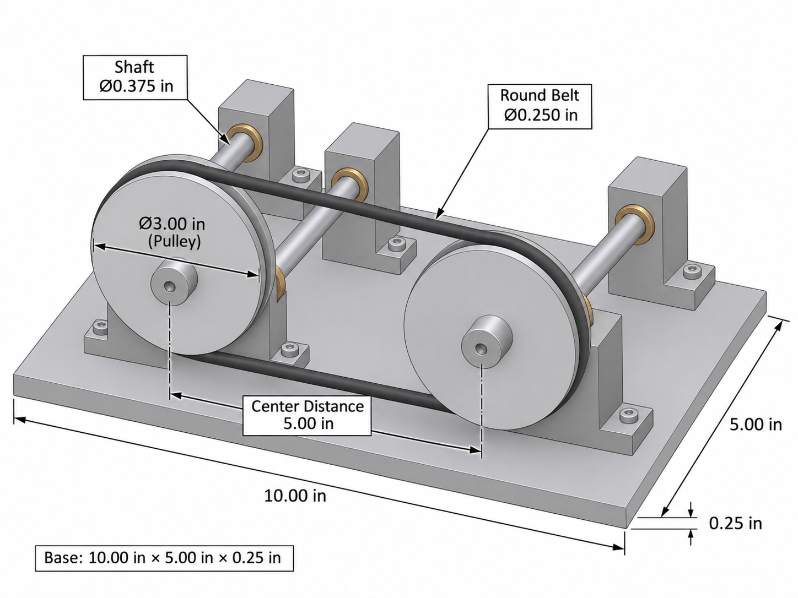
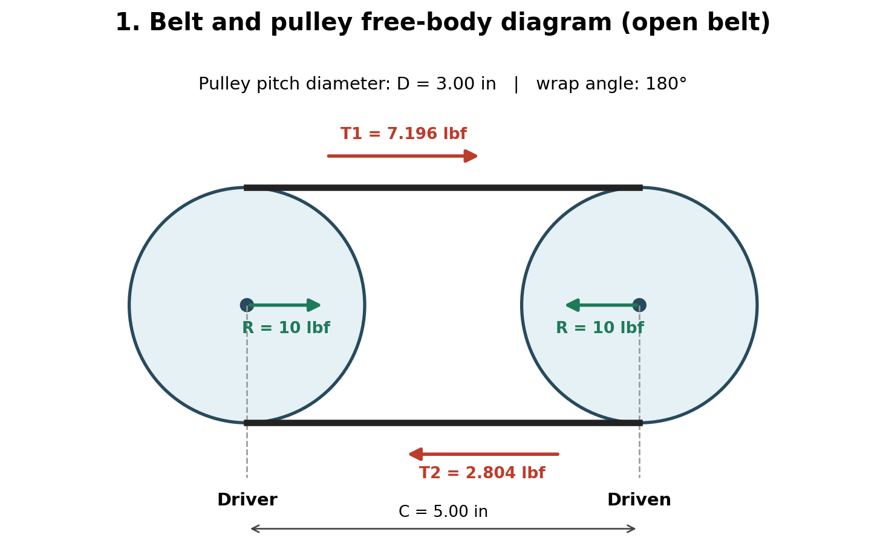
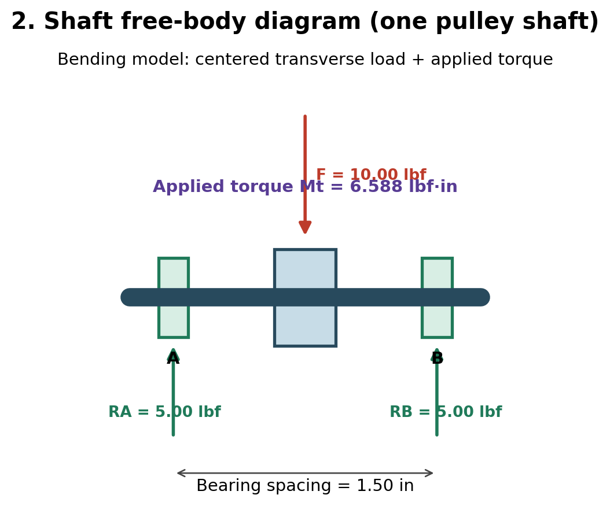
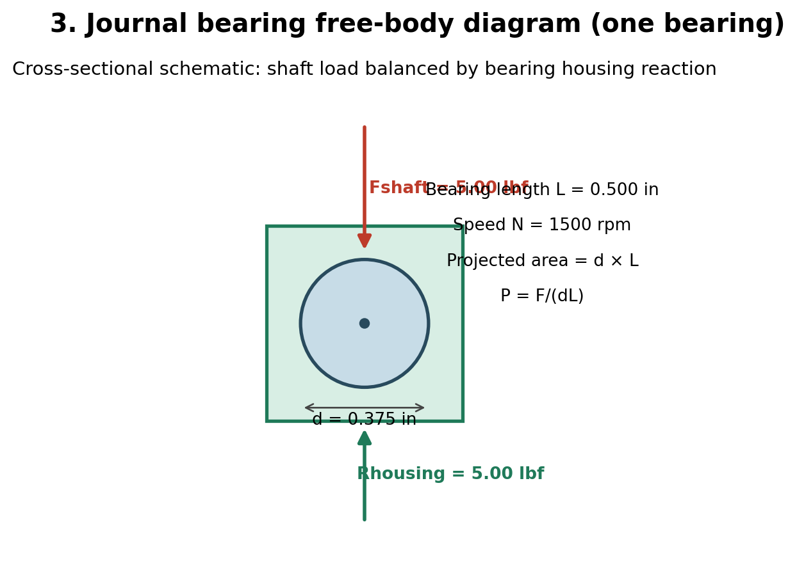

# MEGR 2156 – Assignment 8: Pulley System

**Sophomore Design Project**  
**Status:** Design calculations and concept images completed. Physical build and testing have not been documented.

## Project overview

The goal of this project is to design a belt-driven system that transfers rotation between two parallel shafts. Both pulleys are 3 inches in diameter and are spaced 5 inches apart. I selected a round polyurethane belt, aluminum pulleys and frame, steel shafts, and bronze sleeve bearings. The calculations below cover the belt forces, shaft size, and bearing pressure.

## Pulley system concept

*Figure 1. Simple CAD-style concept of the proposed pulley system. This is a concept picture, not a completed SolidWorks model or built prototype.*

## Design values

| Item | Value |
|---|---|
| Pulley diameter (both) | 3.00 in |
| Pulley center distance | 5.00 in |
| Rotational speed | 1,500 rpm |
| Static belt tension | 5.00 lbf |
| Friction coefficient used | 0.30 |
| Belt | 1/4-in polyurethane round belt |
| Belt yield strength | 471 psi at 20% strain (assignment) |
| Pulleys and frame | 6061-T6 aluminum |
| Shaft | 3/8-in AISI 1060 hardened steel |
| Shaft yield strength used | 97,000 psi |
| Bearings | Oil-impregnated sintered bronze |
| Bearing length | 0.50 in |
| Shaft bearing spacing | 1.50 in |
| Frame base | 10 × 5 × 0.25 in |
| Required factor of safety | At least 3 |

These are the values used to work through the design. The friction coefficient and material properties must match the parts selected for an actual build.

## 2. Belt and pulley design (25%)

### 2.1 Knowns and unknowns

**Known:** `D1 = D2 = 3.000 in`; `C = 5.000 in`; `N1 = 1500 rpm`; `T0 = 5.000 lbf`; `μ = 0.30`; `Sy,b = 471 psi`; required `FS = 3`.

**Unknown:** Tight-span tension `T1`, slack-span tension `T2`, allowable belt stress, required area, minimum belt diameter, belt loop length, shaft torque, belt speed, and transmitted power.

### 2.2 Free-body diagram — belt and pulleys

The upper run is labeled the tight side (`T1`); the lower run is labeled the loose side (`T2`). Each pulley receives the sum of the belt-span forces directed toward the opposite pulley. The effective tangential drive force is the **difference** between the tensions, `T1 − T2`. The bearing load is approximately the **sum**, `T1 + T2`, for parallel belt spans.

### 2.3 Symbolic solution for tight-side and loose-side tensions

For a flat-belt friction model at impending slip:

$$\frac{T_1}{T_2}=e^{\mu\theta}$$

For equal-diameter pulleys, the wrap angle is:

$$\theta=\pi\ \mathrm{rad}$$

Set:

$$k=e^{\mu\pi}$$

The initial static belt tension gives:

$$T_0=\frac{T_1+T_2}{2} \quad\Rightarrow\quad T_1+T_2=2T_0$$

Since `T1 = k T2`:

$$kT_2+T_2=2T_0$$

$$\boxed{T_2=\frac{2T_0}{1+k}}$$

$$\boxed{T_1=\frac{2kT_0}{1+k}}$$

### 2.4 Numerical tension calculation

$$k=e^{0.30\pi}=2.56633$$

$$T_2=\frac{2(5.000)}{1+2.56633}=\boxed{2.8040\ \mathrm{lbf}}$$

$$T_1=10.000-2.8040=\boxed{7.1960\ \mathrm{lbf}}$$

Check:

$$T_1+T_2=7.1960+2.8040=10.000\ \mathrm{lbf}$$

### 2.5 Symbolic minimum belt area and diameter

Allowable tensile stress:

$$\sigma_{\mathrm{allow}}=\frac{S_{y,b}}{FS}$$

Normal tensile stress:

$$\sigma=\frac{T_1}{A}$$

Therefore:

$$A_{\min}=\frac{T_1}{\sigma_{\mathrm{allow}}}=\frac{FS\,T_1}{S_{y,b}}$$

For a round belt:

$$A=\frac{\pi d_b^2}{4}$$

Solve for diameter:

$$\boxed{d_{b,\min}=\sqrt{\frac{4FS\,T_1}{\pi S_{y,b}}}}$$

### 2.6 Numerical minimum belt diameter

$$\sigma_{\mathrm{allow}}=\frac{471}{3}=\boxed{157.0\ \mathrm{psi}}$$

$$A_{\min}=\frac{7.1960}{157.0}=\boxed{0.045834\ \mathrm{in^2}}$$

$$d_{b,\min}=\sqrt{\frac{4(0.045834)}{\pi}}=\boxed{0.24157\ \mathrm{in}}$$

**Selected:** `db = 0.250 in` (nominal 1/4-in round polyurethane belt).

Actual section area:

$$A_{\mathrm{actual}}=\frac{\pi(0.250)^2}{4}=\boxed{0.049087\ \mathrm{in^2}}$$

Tight-span normal stress:

$$\sigma_b=\frac{7.1960}{0.049087}=\boxed{146.60\ \mathrm{psi}}$$

Static tensile safety factor:

$$FS_b=\frac{471}{146.60}=\boxed{3.21}$$

**Result:** The nominal tension-only factor of safety is greater than 3. **This is not a comprehensive belt life or bending-strain check.** The specified 471-psi value corresponds to 20% strain, and belt stretch, pretension, pulley diameter compatibility, and product manufacturer ratings must be verified.

### 2.7 Belt loop length

For an open belt drive, measured along the belt centerline (pitch line):

$$L=2C+\frac{\pi}{2}(D_1+D_2)+\frac{(D_1-D_2)^2}{4C}$$

Because `D1 = D2 = D`:

$$L=2C+\pi D$$

$$L=2(5.000)+\pi(3.000)$$

$$\boxed{L=19.4248\ \mathrm{in}}$$

This is a **geometric belt centerline circumference**, not a verified McMaster product's ordered free length. Purchased belt length must be selected from its manufacturer sizing convention and installation-stretch guidance. The adjustable bearing mounts accommodate belt installation and tensioning.

### 2.8 Belt speed, torque, and ideal power

Equal pulley diameters give equal shaft speeds (neglecting slip):

$$N_1D_1=N_2D_2$$

$$N_2=\frac{N_1D_1}{D_2}=\frac{1500(3)}{3}=\boxed{1500\ \mathrm{rpm}}$$

Belt speed:

$$V_b=\frac{\pi DN}{12}=\frac{\pi(3)(1500)}{12}=\boxed{1178.10\ \mathrm{ft/min}}$$

Tangential driving force at the limiting friction condition:

$$F_t=T_1-T_2=7.1960-2.8040=\boxed{4.3920\ \mathrm{lbf}}$$

Torque:

$$M_t=F_t\frac{D}{2}=(4.3920)(1.500)=\boxed{6.5880\ \mathrm{lbf\cdot in}}$$

Ideal transmitted horsepower at this limit:

$$HP=\frac{M_tN}{63025}=\frac{(6.5880)(1500)}{63025}=\boxed{0.1568\ \mathrm{hp}}$$

$$P=0.1568(745.7)=\boxed{116.9\ \mathrm{W}}$$

**Interpretation:** These are friction-limited theoretical values, not measured test results or guaranteed continuous power rating.

---

## 3. Hardened-steel shaft analysis (25%)

### 3.1 Knowns and unknowns

**Known:** `D = 3.000 in`; `T1 + T2 = 10.000 lbf`; `Mt = 6.5880 lbf·in`; bearing-to-bearing span `Ls = 1.500 in`; shaft design yield strength `Sy,s = 97,000 psi`; required `FS = 3`.

**Unknown:** Bearing reactions `RA` and `RB`, peak bending moment, minimum shaft diameter, bending stress, torsional shear stress, combined von Mises stress, and shaft safety factor.

### 3.2 Free-body diagram — shaft

A pulley is centered between supports `A` and `B`. The net transverse belt load of `10.0 lbf` acts through the pulley center. The shaft also transmits `6.588 lbf·in` of torque. The illustration depicts an isolated pulley shaft; actual support orientation in CAD may be horizontal or vertical as long as the load and reaction directions are consistent.

### 3.3 Symbolic shaft reaction calculation

Force balance:

$$\sum F_y=0: \quad R_A+R_B-F=0$$

Moment about bearing `A`:

$$\sum M_A=0: \quad R_BL_s-F\frac{L_s}{2}=0$$

Solve:

$$\boxed{R_B=\frac{F}{2}}$$

$$\boxed{R_A=F-R_B=\frac{F}{2}}$$

Numerically:

$$R_B=\frac{10.000}{2}=\boxed{5.000\ \mathrm{lbf}}$$

$$R_A=10.000-5.000=\boxed{5.000\ \mathrm{lbf}}$$

### 3.4 Maximum bending moment

The maximum bending moment is directly under the centered pulley:

$$M_{\max}=R_A\frac{L_s}{2}=\frac{FL_s}{4}$$

$$M_{\max}=\frac{10.000(1.500)}{4}=\boxed{3.750\ \mathrm{lbf\cdot in}}$$

### 3.5 Symbolic minimum shaft diameter

For a solid circular shaft:

$$\sigma_b=\frac{32M_{\max}}{\pi d_s^3}$$

$$\tau_t=\frac{16M_t}{\pi d_s^3}$$

Von Mises combined stress:

$$\sigma_{vm}=\sqrt{\sigma_b^2+3\tau_t^2}$$

Substitute both stress formulas:

$$\sigma_{vm}=\frac{\sqrt{(32M_{\max})^2+3(16M_t)^2}}{\pi d_s^3}$$

For the required factor of safety:

$$\sigma_{vm}\le\frac{S_{y,s}}{FS}$$

Rearrange:

$$\boxed{d_{s,\min}=\left[\frac{FS\sqrt{(32M_{\max})^2+3(16M_t)^2}}{\pi S_{y,s}}\right]^{1/3}}$$

### 3.6 Numerical shaft diameter

Allowable yield stress:

$$\sigma_{\mathrm{allow}}=\frac{97000}{3}=\boxed{32333.3\ \mathrm{psi}}$$

Substituting:

$$d_{s,\min}=\left[\frac{3\sqrt{(32\cdot3.750)^2+3(16\cdot6.5880)^2}}{\pi\cdot97000}\right]^{1/3}$$

$$\boxed{d_{s,\min}=0.12908\ \mathrm{in}}$$

**Selected shaft:** `ds = 0.375 in` (3/8 in).

### 3.7 Shaft stress and factor-of-safety verification

$$\sigma_b=\frac{32(3.750)}{\pi(0.375)^3}=\boxed{724.33\ \mathrm{psi}}$$

$$\tau_t=\frac{16(6.5880)}{\pi(0.375)^3}=\boxed{636.25\ \mathrm{psi}}$$

$$\sigma_{vm}=\sqrt{(724.33)^2+3(636.25)^2}=\boxed{1318.75\ \mathrm{psi}}$$

$$FS_s=\frac{97000}{1318.75}=\boxed{73.55}$$

**Result:** The nominal smooth-shaft static yield factor of safety exceeds 3. The very high computed factor indicates a conservatively sized shaft under these light loads; it does **not** establish resistance to keyway stress concentrations, pulley attachment failure, shaft deflection, fatigue, or misalignment. Check these features in the constructed assembly.

---

## 4. Journal bearing analysis (30%)

### 4.1 Knowns and unknowns

**Known:** Each shaft carries two bearings; centered shaft load `F = 10.000 lbf`; load per bearing `Fb = 5.000 lbf`; shaft diameter `ds = 0.375 in`; bearing length `Lb = 0.500 in`; shaft speed `N = 1500 rpm`.

Design screening limits for selected bronze bearing material:

- Maximum bearing pressure: `Pallow = 2000 psi`.
- Maximum surface speed: `Vallow = 1200 ft/min`.
- Rated PV screening value: `PVallow = 50,000 psi·ft/min`.
- More conservative sustained-use PV check: `PVconservative = 20,000 psi·ft/min`.

**Unknown:** Projected area, bearing pressure, shaft surface speed, PV rating, minimum length, and material suitability.

### 4.2 Free-body diagram — single bearing

The bearing receives a `5.000 lbf` radial load from the shaft and transfers an equal and opposite force to the housing/frame. Bearing projected area is diameter multiplied by axial length, **not** the cylindrical curved surface area.

### 4.3 Bearing pressure

$$A_p=d_sL_b$$

$$A_p=(0.375)(0.500)=\boxed{0.1875\ \mathrm{in^2}}$$

$$P=\frac{F_b}{A_p}=\frac{F_b}{d_sL_b}$$

$$P=\frac{5.000}{0.1875}=\boxed{26.667\ \mathrm{psi}}$$

Pressure check:

$$26.667<2000\ \mathrm{psi}\quad\checkmark$$

### 4.4 Surface velocity

$$V=\frac{\pi d_sN}{12}$$

$$V=\frac{\pi(0.375)(1500)}{12}=\boxed{147.262\ \mathrm{ft/min}}$$

Speed check:

$$147.262<1200\ \mathrm{ft/min}\quad\checkmark$$

### 4.5 PV product

$$PV=P\times V$$

$$PV=(26.667)(147.262)=\boxed{3927.0\ \mathrm{psi\cdot ft/min}}$$

Check against the sustained-use screening value:

$$3927.0<20000\ \mathrm{psi\cdot ft/min}\quad\checkmark$$

### 4.6 Minimum bearing length

Substitute `P = Fb/(ds Lb)` and `V = π ds N/12` into `PV = P V`:

$$PV=\left(\frac{F_b}{d_sL_b}\right)\left(\frac{\pi d_sN}{12}\right)$$

Cancel shaft diameter:

$$PV=\frac{\pi F_bN}{12L_b}$$

Solve for the minimum length:

$$\boxed{L_{b,\min}=\frac{\pi F_bN}{12PV_{\mathrm{allow}}}}$$

Use the sustained-use screening limit:

$$L_{b,\min}=\frac{\pi(5.000)(1500)}{12(20000)}=\boxed{0.09817\ \mathrm{in}}$$

**Selected bearing:** 3/8-in bore × 1/2-in axial length oil-impregnated sintered-bronze sleeve bearing. Outside diameter, fit, clearance, lubricant compatibility, and actual operating limits are to be matched to the purchased part's datasheet.

---

## 5. Frame and CAD design (15%)

### 5.1 Concept geometry

- Base: `10 in × 5 in × 0.25 in` aluminum 6061-T6 plate.
- Shafts: parallel and `5.00 in` apart at the design belt tension.
- Pulleys: 3.00-in nominal pitch diameter, coplanar to prevent belt tracking problems.
- Bearing arrangement: **two supports per shaft**, with the pulley centered between support centers `1.50 in` apart.
- Drive shaft: fixed in position.
- Driven shaft: two bearing supports adjusted **together** using slotted mounting holes.
- Belt guards: cover rotating pulley rims, belt runs, and pinch points for powered testing.

### 5.2 Frame loads

The approximately horizontal resultant pulley load is:

$$F_{\mathrm{pulley}}=T_1+T_2=7.1960+2.8040=\boxed{10.000\ \mathrm{lbf}}$$

For a centered pulley between two supports:

$$R_A=R_B=\frac{10.000}{2}=\boxed{5.000\ \mathrm{lbf}}$$

The belt pulls the two shafts **toward each other**. The frame must resist these opposing loads while keeping the shaft axes parallel. A local support that carries one bearing must resist `5.0 lbf` radial bearing reaction at the selected operating load model.

### 5.3 Frame design process

1. Create the base plate and set the shaft centerlines 5.00 in apart.
2. Model four bearing supports with aligned cylindrical bores.
3. Set bearing-center spacing on each shaft to 1.50 in.
4. Create 3-in pitch-diameter pulleys with a **round-belt-compatible groove**, 3/8-in bores, and suitable hubs/shaft attachments.
5. Model two 3/8-in steel shafts; finalize length based on bearings, collars, motor coupling, and guard clearance.
6. Use slots and shared alignment hardware to move the driven shaft supports together for belt tension adjustment.
7. Verify clearances between belt, pulleys, frame, and mounting fasteners.
8. Check pulley-hub fastening, shaft axial retention, bearing mounting, and frame stiffness prior to power-on testing.

**Frame verification still required:** Exact support shape, fasteners, mounting slot edge distances, bending stress, deflection, motor mount, and guard design depend on CAD dimensions and chosen hardware. They cannot be verified from the base-plate dimensions alone.

---

## 6. Problems to check during assembly

The two main concerns are belt tension and alignment. If the belt is too loose, it may slip; if it is too tight, the bearings will carry more load. The driven shaft mounts can be moved to adjust belt tension. Both shafts also need to remain parallel so the belt stays in the pulley grooves.

Other possible problems are a pulley slipping on its shaft, bearings binding if their holes do not line up, or vibration from loose parts. If these problems happen during the build, I will record what happened, what I changed, and whether the change worked. **No actual fabrication problems have been recorded yet.**

## 7. Final test measurements

The table shows the design targets. The measured results will be filled in after the system is built and tested.

| Measurement | Design target | Test result |
|---|---:|---|
| Pulley diameter | 3.00 in | Not tested |
| Center distance | 5.00 in | Not tested |
| Static belt tension | 5.00 lbf | Not tested |
| Input shaft speed | 1,500 rpm | Not tested |
| Output shaft speed | 1,500 rpm without slip | Not tested |
| Belt tracking | Runs in groove | Not tested |
| Bearing temperature | Record after running | Not tested |
| Vibration/noise | Record observations | Not tested |

To test the completed system, I would first check the mounting bolts, shaft alignment, and belt position with the power off. With guards in place, I would start at low speed and check belt tracking. Then I would measure input and output speeds with a tachometer. Any adjustment would be made after shutting off the power.

Speed difference can be calculated with:

$$\%\text{ speed difference}=\frac{|N_1-N_2|}{N_1}\times100$$

## 8. What I learned from the design calculations

The tight and loose belt tensions are different when a pulley transmits torque. I used this difference to calculate the maximum torque the belt could transmit using the selected friction value. I also learned that a shaft needs to be checked for bending and twisting at the same time. Finally, journal bearings are checked with pressure and surface speed, not just the force acting on them.

## 9. Work and time log

| Task | What is available | Time |
|---|---|---|
| Select design dimensions | Design table | Not recorded |
| Calculate belt forces and diameter | Equations in Section 2 | Not recorded |
| Size the shafts | Equations in Section 3 | Not recorded |
| Check journal bearings | Equations in Section 4 | Not recorded |
| Develop frame layout | CAD-style concept image | Not recorded |
| Make and test the prototype | Not completed/documented | Not recorded |

## 10. Final design results

| Result | Value |
|---|---:|
| Tight-side belt force | 7.196 lbf |
| Loose-side belt force | 2.804 lbf |
| Minimum belt diameter | 0.2416 in |
| Chosen belt diameter | 0.250 in |
| Belt safety factor (tensile check) | 3.21 |
| Belt centerline length | 19.425 in |
| Limiting torque from belt tension calculation | 6.588 lbf·in |
| Minimum shaft diameter | 0.1291 in |
| Chosen shaft diameter | 0.375 in |
| Shaft safety factor (smooth shaft, static load) | 73.6 |
| Pressure on each bearing | 26.67 psi |
| Bearing surface velocity | 147.26 ft/min |
| Bearing PV | 3,927 psi·ft/min |

## References

- MEGR 2156 Assignment 8: Pulley System (assignment instructions).
- [McMaster-Carr Round Belts](https://www.mcmaster.com/products/round-belts/).
- *Machinery's Handbook*, journal bearing PV tables referenced in the assignment.
- D. J. Dunn, *Solid Mechanics – Dynamics: Tutorial – Pulley Drive Systems* (assigned reading).

