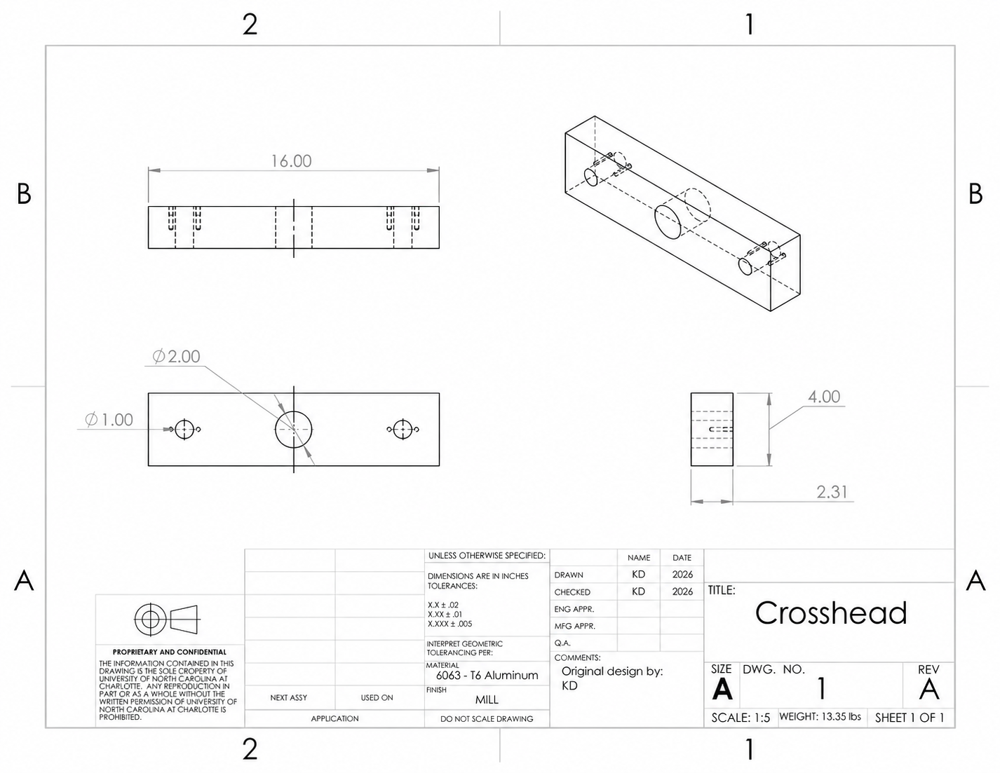
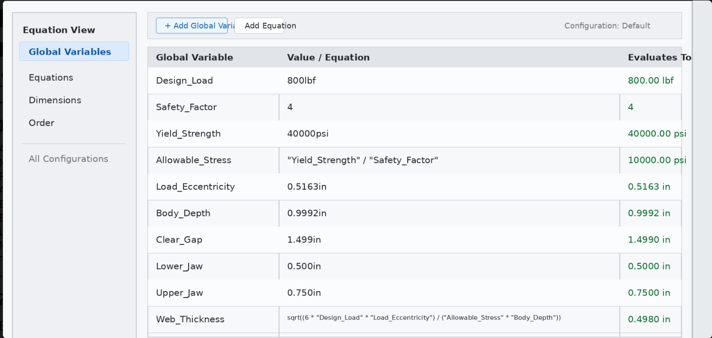

# A11: Motor Selection and Tensile Tester Assembly

**Kaleb Dedrick**  
**Sophomore Design — Part 2**  
**Project:** Bench-top dual-lead-screw tensile tester

## Project overview

For this assignment, I continued developing a bench-top tensile tester designed to apply a total axial load of **2 kN** while moving the crosshead at **1–50 mm/min**. I selected stepper motors, evaluated the motor mounting brackets and shaft couplers, analyzed frame connectors, documented finite element analysis (FEA) of the upper crossmember and vertical supports, and modeled a floating bearing mount. I also assembled the parts in SolidWorks and prepared engineering drawings and a cost estimate.

This page records the calculations and results presented in my A11 report. The FEA figures and numerical results are reproduced as reported and should be checked against the underlying SolidWorks simulation before treating the structure as fully verified.

## Design requirements

| Requirement | Design target |
|---|---|
| Total tensile load | 2,000 N |
| Load per lead screw (equal-share assumption) | 1,000 N |
| Crosshead speed | 1–50 mm/min |
| Lead | 2.54 mm/rev |
| Number of lead screws and motors | 2 each |
| Minimum lead screw length | 18 in |
| Structural design safety factor | 4 |
| Frame | Bench-top T-slot aluminum |
| Bearing support | Floating support with RC3 shaft fit |
| Mechanical scope | No control electronics/software in the assignment scope |

## 1. Motor torque and speed selection

### Knowns and unknowns

| Known | Value |
|---|---:|
| Axial load per screw | 1,000 N |
| Calculated drive torque per screw | 1.28 N·m |
| Screw lead | 2.54 mm/rev |
| Crosshead velocity | 1–50 mm/min |
| Required screw speed | 0.394–19.7 rpm |

**Unknowns:** suitable motor torque, rated speed range, and available output torque at the operating speed.

### Speed and power check

The screw speed follows from the crosshead travel speed and lead:

$$n=\frac{v}{L}$$

$$n_{min}=\frac{1}{2.54}=0.394\text{ rpm}$$

$$n_{max}=\frac{50}{2.54}=19.7\text{ rpm}$$

At the maximum speed, I used angular speed and rotational power:

$$\omega=19.7\left(\frac{2\pi}{60}\right)=2.06\text{ rad/s}$$

$$P=T\omega=(1.28)(2.06)\approx 2.64\text{ W per screw}$$

The design uses two motors, each driving one lead screw. The torque and power checks above represent the report's calculated screw-side requirements, not total electrical input power.

*Figure 1. Hand calculations for screw speed and power.*

*Figure 2. Selected NEMA 23 stepper motor.*

*Figure 3. NEMA 23 mounting and overall motor dimensions.*

*Figure 4. Manufacturer torque-speed curve at 36 V.*

### Selected motor

I selected a **NEMA 23 bipolar CNC stepper motor**, model **23HS45-4204S**, listed with **3.0 N·m** holding torque. The motor mounting pattern is suitable for a standard NEMA 23 bracket. The supplied torque-speed figure was used to compare the required **1.28 N·m** torque against the operating speed range of **0.394–19.7 rpm**.

Using the listed 3.0 N·m rating as a simple comparison gives a torque ratio of about **2.34**, which is below the general project factor-of-safety target of 4 if that target is applied directly to motor torque. The motor also requires a driver to operate; this should be reconciled with the assignment's “no electronics” scope.

## 2. Motor mount bracket

### Known inputs

| Quantity | Value |
|---|---:|
| Applied torque at one motor | 1.28 N·m |
| Mounting bolts | 4 |
| Motor mounting bolt center spacing | 47.14 mm |
| Distance from shaft center to bolt (used in report) | 33.33 mm |
| Assumed bolt hole diameter | 5.5 mm |
| Material | Aluminum 6063-T6 |
| Assumed yield strength | 214 MPa |
| Safety factor | 4 |

The bracket is an L-shaped mount fixed to the frame. I used a simple bolt-group torque model and bearing stress in the plate to estimate a minimum thickness.

$$F_b=\frac{T}{4r}=\frac{1.28}{4(0.03333)}\approx9.60\text{ N per bolt}$$

$$\sigma_{allow}=\frac{S_y}{SF}=\frac{214}{4}=53.5\text{ MPa}$$

$$t_{min}=\frac{F_b}{\sigma_{allow}d_{hole}}\approx 0.0327\text{ mm}$$

This is the **minimum thickness from the simplified bolt bearing check only**. It does not check bracket bending, stiffness, fatigue, or the actual frame reaction forces. I therefore treated rigidity, alignment, and manufacturability as important considerations for the actual bracket.

*Figure 5. Free-body diagram of the motor mount bracket.*

*Figure 6. Bracket bearing stress and minimum thickness calculation.*

*Figure 7. Initial L-shaped bracket design.*

*Figure 8. Original motor bracket with reinforcement ribs.*

*Figure 9. Original bracket dimensional reference.*

*Figure 10. Modified motor bracket CAD model after rib removal.*

I found a bracket that matched the NEMA 23 motor pattern, imported it into SolidWorks, and removed side ribs with an extruded cut so it could fit flush against the frame. The mounting slots allow some adjustment during assembly to help align the motor shaft and lead screw.

## 3. Shaft coupler selection and torsional analysis

The coupler transfers torque from the motor shaft to the lead screw. I analyzed a hollow cylindrical coupler using the torsion equation, then selected an off-the-shelf clamping shaft coupling from McMaster-Carr.

### Knowns and unknowns

| Quantity | Value |
|---|---:|
| Design safety factor | 4 |
| Material yield strength used in report | 1,100 MPa |
| Torque used | 11.338 in·lbf (about 1.28 N·m) |
| Initial bore diameter | 0.3937 in |
| Unknowns | Minimum outer diameter and wall thickness |

$$\tau=\frac{Tc}{J},\qquad J=\frac{\pi(D_o^4-D_i^4)}{32},\qquad c=\frac{D_o}{2}$$

The report's calculated outer diameter was approximately **0.61623 in**, which corresponds to a radial wall thickness of:

$$t=\frac{D_o-D_i}{2}=\frac{0.61623-0.3937}{2}=0.11127\text{ in}$$

A commercially available clamping shaft coupling was selected to simplify assembly and keep the lead screw and motor connected. The selected coupling should be checked for exact bore diameters, allowable torque, and shaft misalignment.

*Figure 11. Coupler free-body diagram showing torsion.*

*Figure 12. Coupler knowns, unknowns, and torsion equations.*

*Figure 13. Coupler outside diameter and wall-thickness calculations.*

## 4. Frame and connector analysis

For the upper frame connections I compared **inside corner brackets** with **side plate connectors**. I chose a side plate concept because it offers more contact area at the crossmember-to-upright joint. The report identifies the chosen connector as part **45-4351**.

### Frame analysis quantities

| Quantity | Reported value |
|---|---:|
| Nominal force listed in knowns | 1 kN |
| Frame connector moment arm | 56.642 mm |
| Frame second moment of area | 139,604 mm⁴ |
| Bracket section inertias | 45,562.5 mm⁴ and 810 mm⁴ |
| Material yield strength | 215 MPa |
| Design safety factor | 4 |

The report uses the basic bending stress relationship:

$$\sigma=\frac{Mc}{I}=\frac{M}{Z}$$

The reported analytical stresses include **36.52 MPa** for one frame direction, **0.206 MPa** from the motor torque moment, **112 MPa** for one bracket direction, and **4.74 MPa** for the other bracket direction. Some calculations use a **4 kN** force despite the stated **2 kN total system load**. This difference needs to be resolved when validating the final design.

*Figure 14. T-slot corner bracket versus plate connector options.*

*Figure 15. Selected plate connector.*

*Figure 16. Frame front-view free-body diagram.*

*Figure 17. Frame top-view torque free-body diagram.*

*Figure 18. Connector front-view free-body diagram.*

*Figure 19. Connector top-view free-body diagram.*

## 5. Top crossmember finite element analysis

I evaluated the top crossmember with fixed interfaces at the connections to the vertical posts. The simulation applied **1 kN** at each lead-screw location and **1.28 N·m** moments at the motor/lead-screw interfaces. Three mesh densities were tested and stress, displacement, safety factor, and element counts were recorded.

| Quantity | Test 1 | Test 2 | Test 3 |
|---|---:|---:|---:|
| Reported maximum stress (Pa) | 4.35×10⁸ | 7.245×10⁸ | 6.383×10⁸ |
| Maximum displacement (mm) | 0.3902 | 0.3957 | 0.3978 |
| Reported minimum safety factor | 4.820 | 2.950 | 3.348 |
| Elements | 353,763 | 1,012,742 | 1,470,165 |
| Stress change from previous mesh | — | 49.94% | 12.65% |
| Deflection change from previous mesh | — | 1.399% | 0.5293% |
| Safety-factor change | — | 48.13% | 12.64% |

**Interpretation:** The deflection results were fairly consistent at the last two meshes, but the stress estimates varied more. The listed peak stresses do **not** reconcile with the reported safety factors when compared with the approximately 214–215 MPa aluminum yield strength used elsewhere in the report. I would need to check simulation units, material definitions, and singularities before stating that this crossmember meets the factor-of-safety requirement.

### Proposed optimization

The report proposes replacing a single-width **45×45** upper member with a double-width **45×90** member to improve stiffness and increase cross-sectional area. This is a proposed revision; the new geometry is not shown as a verified final FEA pass.

*Figure 20. Top crossmember FEA restraints and applied loads.*

*Figure 21. Three-mesh comparison: top crossmember stress, displacement, and reported safety factor.*

## 6. Vertical frame member finite element analysis

The upright simulation used an axial force of **1 kN** and a transverse representation of the motor reaction torque. I compared three meshes for stress, displacement, and reported safety factor.

| Quantity | Test 1 | Test 2 | Test 3 |
|---|---:|---:|---:|
| Maximum stress (Pa) | 1.126×10⁶ | 1.316×10⁶ | 1.297×10⁶ |
| Maximum displacement (mm) | 0.002445 | 0.002542 | 0.002531 |
| Reported minimum safety factor | 1,897 | 1,625 | 1,648 |
| Elements | 423,212 | 883,631 | 1,528,706 |
| Stress change from previous mesh | — | 15.56% | 1.454% |
| Deflection change from previous mesh | — | 3.890% | 0.4337% |
| Safety-factor change | — | 15.46% | 1.405% |

The report suggests the vertical components may be overbuilt and could be changed to single-width **45×45** frame members to reduce cost. The effect of that substitution on the complete frame would need to be checked before it becomes the final design.

*Figure 22. Vertical support FEA applied load setup.*

*Figure 23. Three-mesh comparison of vertical support stress, deflection, and safety factor.*

## 7. Floating bearing mount

The bearing support keeps the lower end of the lead screw aligned while allowing it to turn. I designed a mount around a sleeve bearing with an **RC3 running fit** at the shaft. The mount attaches to the T-slot base using T-bolts and flange nuts, making the position adjustable during assembly.

The housing evolved from a simple plate-and-flange concept to a complete assembly with a base, bearing holder, sleeve bearing, and fasteners. I shortened the original design and repositioned the attachment holes to fit the surrounding frame and hardware.

*Figure 24. Initial base component sketch.*

*Figure 25. Initial bearing-holder flange geometry.*

*Figure 26. First CAD bearing holder.*

*Figure 27. Sleeve bearing used for RC3 fit concept.*

*Figure 28. T-slot mounting bolt.*

*Figure 29. Distorted-thread flange nut.*

*Figure 30. Early bearing mount assembly.*

*Figure 31. First assembly attempt with incorrect length and bolt positioning.*

*Figure 32. Modified mounting base sketch.*

*Figure 33. Adjusted bearing-holder flange dimensions.*

*Figure 34. Final floating bearing mount CAD assembly.*

The final model uses an oil-embedded bronze sleeve bearing and T-slot fastening hardware. The report identifies RC3 as the intended shaft fit but does not give a numerical fit table or minimum/maximum shaft and bore dimensions; those would be needed for a manufacturing drawing.

## 8. Completed tensile tester assembly

I brought the motors, mounting brackets, lead screws, crosshead, bearings, frame connectors, and load-cell support into the SolidWorks assembly. Assembly mates were used to position the components relative to the frame and one another. I found a gap between a motor bracket and the side mounting surface, so **9/16-inch spacers** were added to fill that gap.

The illustrations show the complete frame, motor arrangement, lower screw-support area, and top crossmember connection.

*Figure 35. Completed tensile tester assembly views.*

*Figure 36. Motor locations and mounting brackets.*

*Figure 37. Lower frame, bearings, and load-cell interface.*

*Figure 38. Top crossmember plate bracket.*

## 9. Bill of materials and material costs

The following are the **costs listed in the submitted A11 report**, not updated vendor quotations.

| Part no. | Qty. | Component | Reported cost |
|---|---:|---|---:|
| 91523A251 | 4 | Steel machined-neck T-slot bolt | $42.40 |
| 6391K212 | 2 | Oil-embedded bronze sleeve bearing | $3.26 |
| 90426A130 | 4 | Distorted-thread flange nut (pack price) | $13.96 |
| 61005K522 | 2 | Clamping shaft coupling | $111.52 |
| ST-M2 | 2 | NEMA 23 motor bracket | $4.50 |
| 23HS45-4204S | 2 | NEMA 23 3 N·m stepper motor | $57.40 |
| 98940A625 | 2 | Lead screw | $100.92 |
| 97790A110 | 2 | Lead screw flange nut | $357.20 |
| 14720 | 1 | Crosshead | $234.61 |
| 804TA9 | 1 | Single-width frame stock | $103.96 |
| 804T44 | 1 | Double-width frame stock | $365.69 |
| 6131N49 | 1 | Load cell | $284.93 |
| 5JRR8 | 2 | Angled frame connector | $32.54 |
| 92414A465 | 2 | Unthreaded spacer | $3.14 |
| Rh-45 | 1 | Rhodium material | $300,510.00 |
| W-74 | 1 | Tungsten material | $3,431.54 |
| | | **Reported materials total** | **$305,657.57** |

### Engineering labor estimate

| Work area | Estimated hours | Rate | Labor cost |
|---|---:|---:|---:|
| Motor selection and motor bracket | 17 | $35/hour | $595 |
| Coupler and floating bearing mount | 15 | $35/hour | $525 |
| Frame analysis and full assembly | 20 | $35/hour | $700 |
| **Total** | **52** | | **$1,820** |

**Total project cost stated in report: $307,477.57** (materials plus estimated design labor). The 52 hours represent the combined original work-area estimates and are not an independently verified personal timesheet.

## 10. Engineering drawings

The drawing package includes the bearing mount, crosshead, motor mount bracket, and complete tensile tester assembly. These sheets show orthographic and isometric views with dimension callouts and title blocks. The drawing images below are from the supplied A11 photo archive.

*Figure 39. Bearing mount engineering drawing.*

*Figure 40. Crosshead engineering drawing.*

*Figure 41. Motor mount bracket engineering drawing.*

*Figure 42. Tensile tester assembly engineering drawing.*

## 11. Problems encountered and design changes

The main issues during the assignment involved making the real purchased components fit the CAD model and getting the frame simulations set up properly. I modified the motor bracket to remove ribs that would have interfered with its mounting position, changed the bearing holder after finding that the original design was too long and had poorly located bolts, and added spacers where the motor bracket left a gap. The frame FEA also required careful choices for fixtures and load directions. A split face at the top support caused trouble in the assembly model, so the simulation setup had to be adjusted.

## 12. Lessons learned

Through this assignment, I learned how the different components of a tensile tester work together and how important it is to consider both calculations and practical design requirements. I learned how leadscrew torque determines motor selection and how using two motors distributes the load between them. I also gained a better understanding of torque-speed curves and how to make sure a motor provides enough torque at the required operating speed. When designing the motor bracket, I found that the calculated minimum thickness was extremely small, which showed me that factors like stiffness, alignment, and manufacturability can be just as important as stress calculations. I also gained experience modifying parts in SolidWorks, such as removing reinforcing ribs with an extruded cut to allow the bracket to sit properly on the frame.

For the coupler and bearing mount, I learned how to use torsional shear stress equations and a safety factor to determine whether a coupler could safely handle the required torque. I also learned the difference between rigid connections and floating supports and why proper alignment is important. Selecting standard components from McMaster-Carr helped me understand how real-world designs depend on available parts rather than just ideal calculations. One of the biggest challenges was performing FEA on the frame because I had not done much analysis on assemblies before. I had issues with setting up the correct fixtures and loads, especially when trying to use a split face on the crossbeam to represent its connection to the vertical supports. This caused problems with the assembly, so I had to make adjustments to complete the analysis. I also had to figure out how to account for the torque from both motors acting on the crossbeam. Overall, this assignment helped me become more comfortable with SolidWorks assemblies, FEA, and applying engineering calculations to actual designs. I also learned that even when the calculations seem correct, the CAD model and simulation setup can introduce problems that need to be worked through before finalizing a design.

## 13. CAD files

The downloadable SolidWorks CAD package should contain the assembly, associated parts, and engineering drawings.

**[Download the complete A11 SolidWorks CAD package](A11_Kaleb_Dedrick_SolidWorks_CAD.zip)**

## 14. Additional reference material

The supplied image archive also contains a SolidWorks evaluation-values screenshot, included below for reference.

*Figure 43. SolidWorks evaluation values screenshot from the supplied images.*

